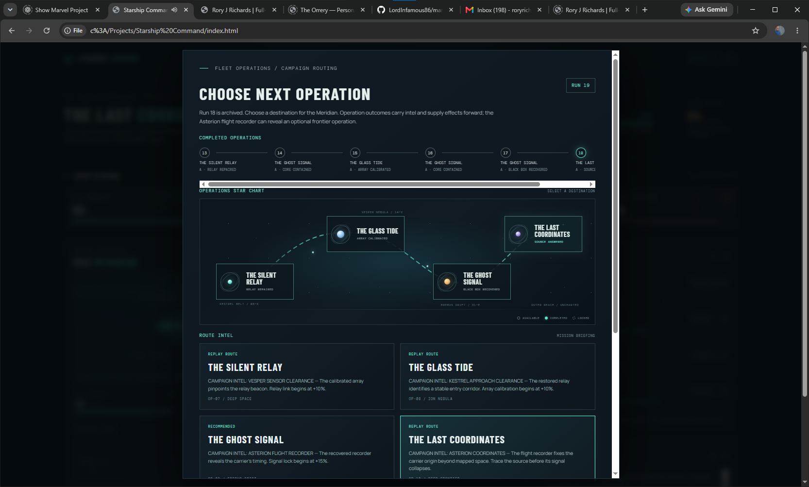
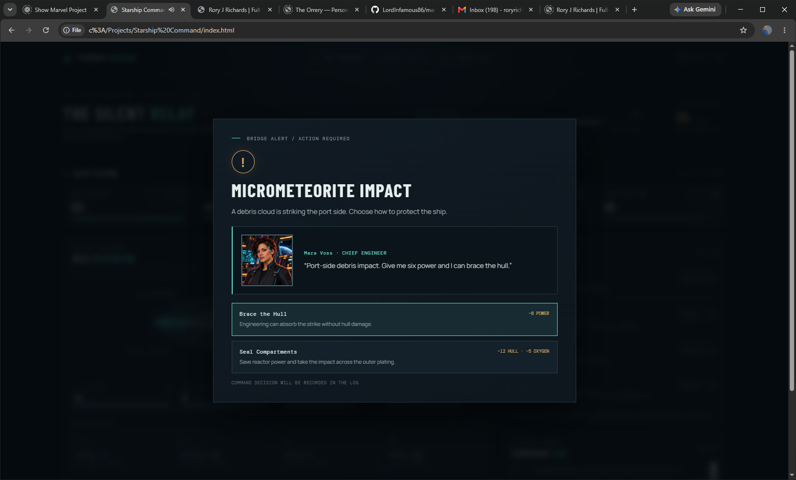
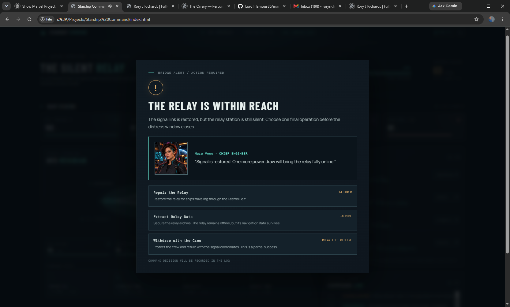
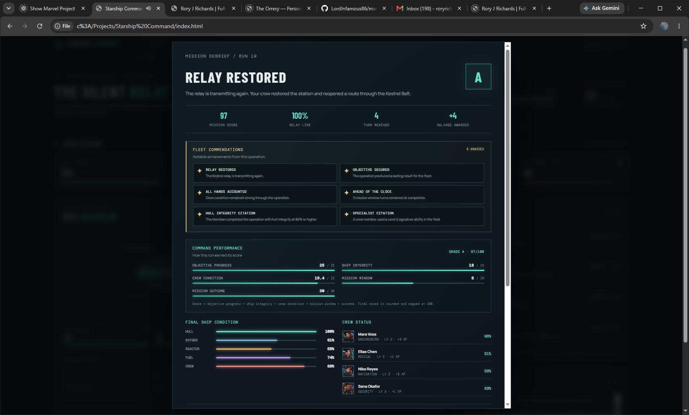
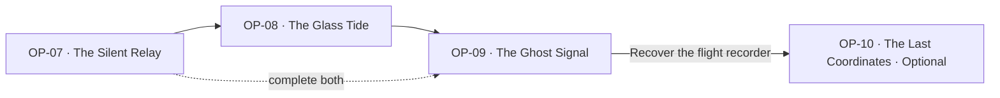

# Starship Command — The Silent Relay

A browser-playable science-fiction operations game about commanding the UES Meridian through a connected series of crises. Assign specialists, manage ship resources, make consequential choices, and carry mission intel forward. The project separates a DOM-free simulation engine from the browser interface and optional local campaign API.

**[▶ Play the live demo](https://lordinfamous86.github.io/Starship-Command/)**

## Portfolio overview

- **Four connected operations:** Silent Relay, Glass Tide, Ghost Signal, and the optional Last Coordinates epilogue.
- **Branching mission outcomes:** repair, recover data, chart routes, contain threats, or extract the crew. Results alter later briefings, starting resources, and crisis choices.
- **Crew-driven command:** four specialists have portraits, dialogue, assignments, persistent experience, and signature abilities.
- **Campaign persistence:** debriefs, commendations, archives, refits, and the campaign finale preserve the story across sorties.
- **Responsive interface:** animated ship telemetry, mission scenery, crisis overlays, campaign routing, and reduced-motion support.
- **Guided first launch:** a commander orientation explains the controls and campaign route before the first mission briefing.

## Screenshots

| Campaign routing | Character-led crisis |
| --- | --- |
|  |  |

| Mission decision | Mission debrief |
| --- | --- |
|  |  |

## Visual tour

[Open the four-scene campaign tour](docs/portfolio-tour.html) to step through the campaign map, crew crisis dialogue, a consequential mission choice, and the debrief. It uses the screenshots above and runs locally without external libraries.

## Campaign walkthrough



Restore the relay and complete the Glass Tide to open the Asterion investigation. At the Ghost Signal finale, recovering the flight recorder reveals the optional source-tracing operation. Other outcomes still affect later routes through intel, supplies, crew recovery, or damage.

The campaign map previews available operations and their unlock requirements. Before committing to a route, review its briefing or return to the map to choose another mission.

## Run the game with campaign API

1. Install Node.js 18 or newer.
2. From this folder, run `npm start`.
3. Open `http://127.0.0.1:3000` in a browser.

The server creates and loads campaigns, applies commands through `engine.js`, and saves the resulting state in `data/campaigns.json`. The browser keeps a local backup. The server binds to `127.0.0.1` so the API is only available on this computer.

You can still open `index.html` directly; that runs in local-save mode without the API.

## Build a shareable static demo

Create a clean static-hosting package with:

```sh
npm run build:static
```

The generated `dist/` folder contains only the playable browser app, its images and sound code, and the campaign visual tour. Upload that folder to a static host or configure a host to run `npm run build:static` and publish `dist/`. With no campaign API available, the game automatically uses browser-local saves. Each visitor's campaign stays in that browser and is not shared across devices. Local API-backed play remains available with `npm start`.

## Mission loop

- Assign crew to Engineering, Navigation, Medical, or Security. Assignments are free and can improve commands or emergency outcomes.
- Repair Hull, Stabilize Core, and Scan Relay each cost one turn. Advance Turn also costs one turn. Every turn consumes 5 oxygen and advances the distress window.
- Events pause play for a decision. Choices trade reactor power, fuel, hull, oxygen, or crew condition. The selected crew specialist affects the available costs or consequences.
- After each mission, the campaign map shows completed operations and lets you choose a route: restore the Silent Relay, navigate the Glass Tide, or—after completing both—investigate the Ghost Signal from a missing courier. Recovering the Asterion flight recorder reveals the optional fourth operation, The Last Coordinates. Operations can be replayed and have their own briefings, crises, and final choices.
- Complete the operation objective before its distress or storm window closes, then select the primary objective, secure mission data, or withdraw with the crew.
- The mission debrief grades the run, reports ship and crew condition, and summarizes emergency decisions. Launching the next operation archives the completed report in the campaign.
- Mission outcomes shape later operations with starting resources, objective progress, and intel-specific crisis choices. Restoring the Kestrel Relay can reveal a safe Glass Tide corridor; recovering its archive can help decode an ion echo. Vesper Array data or a mapped tide route can each unlock a distinct option in The Ghost Signal.
- Crew dialogue in later briefings reacts to the previous operation. After the Ghost Signal, the campaign finale summarizes the first three operations; recovering the Asterion flight recorder also unlocks The Last Coordinates, an optional epilogue that can change the finale.
- The campaign map can archive the current operation history and start a fresh campaign. Saved campaign archives remain available in the archive viewer, including mission grades, outcomes, and key decisions. Server-backed play starts a separate campaign record instead of replacing the prior one.
- Mission grades and outcomes award salvage. Between operations, commanders can spend it on permanent sensor, reactor, and hull upgrades; these refits persist through the campaign and reset when a new campaign begins.
- Crew members gain experience from each sortie and additional field contributions. At Level 2, each specialist unlocks a signature ability with a gameplay effect and unique crisis dialogue; level and skill persist across operations, and ability callouts appear in the campaign timeline.

Crew assignments, commands, and emergency choices use the campaign API when the game is opened through `npm start`. The browser-local save provides recovery and direct-file play.

## Code structure

- `engine.js` contains the simulation rules: initial state, crew assignments, command costs, turn advancement, event outcomes, mission endings, debrief scoring, and continuity between runs. It has no DOM or storage access and runs in both the browser and Node.
- `server.js` serves the game and exposes campaign create, load, and command endpoints. It serializes campaign writes and checks campaign revisions to reject stale commands.
- `sim.js` renders the bridge and sends campaign operations to the server when available.
- `data/campaigns.json` stores local server campaigns and is excluded from version control.

## Tests

Run `npm test` from the project folder. The dependency-free Node test suite checks simulation rules and the API, including campaign persistence, command validation, and stale revisions.

## Storage scope

The API currently uses a local JSON campaign store. PostgreSQL, user sign-in, and private multi-user campaigns are not configured yet. The API binds to localhost and is intended for local development.

## Art and dialogue

Crew portraits are in `crew-portraits.png`; CSS crops each quadrant into the manifest. Event-specific authored dialogue uses the assigned specialist where possible and reacts to the command outcome without changing simulation rules.


## Ship visuals and sound

The Meridian schematic uses layered vector hull panels, deck lights, a reactor glow, and animated engine exhaust. Hull and propulsion condition change the ship lighting and damage indicators. The ♫ control toggles synthesized bridge ambience and interface cues; the preference is saved in this browser. Begin Mission starts/resumes the ambience after a direct click so browsers allow audio playback. No audio files or third-party audio packages are required.
